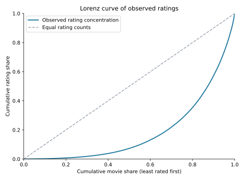

# MovieLens 数据分析：内容评分与候选片单

一个面向数据分析求职的公开数据案例：**从数据来源、处理和 SQL 指标，到 Python 图表、结果解释与建议。**

## 学习入口

**[完整数据分析过程](docs/LEARNING_GUIDE.md)**

适合已经有 Python、SQL 基础的人。教程围绕四个问题，逐一解释为什么用这种方法、怎样计算、实际结果是什么，以及能支持什么建议：

1. 月度评分参与怎样变化：完整月比较、人数与人均量分解。
2. 评分是否集中在少数影片：聚合、窗口排名与累计占比。
3. 多类型影片怎样分析：桥表关联、重复计算与 `1/k` 分摊。
4. 怎样形成口碑候选：样本门槛、收缩加权均分与敏感性检查。

主线不要求先训练预测模型。软件安装放在文末，仅在确实缺少依赖时参考。

## 数据与结果

- MovieLens 100K：100,000 条评分、943 位用户、1,682 部电影。
- 清洗保留全部有效评分；同名不同 ID 不盲删，缺失的非关键日期不补造。
- 类型连接展开为 212,595 行，按 `1/k` 分摊后还原为 100,000 条评分权重。
- 169 部评分最多的影片占评分 42.87%；小样本、年代和主动评分限制了外推。

这里的评分数不等于播放量，月评分用户不等于平台 MAU。案例模拟内容编辑分析任务，不是企业真实运营交付，也不声称带来业务增长。

[查看完整参考报告](reports/analyst/ANALYSIS_REPORT.md) · [质量审计](reports/analyst/audit.json) · [聚合指标](reports/analyst/metrics.json)



## 文件导航

```text
docs/LEARNING_GUIDE.md      # 唯一的主线教材：问题→方法→结果→建议
notebooks/01_explore.ipynb  # 个人执行代码和写观察的工作区
sql/analysis.sql           # 五段可独立执行的命名 SQL（SQLite 方言）
src/rating_lab/analyst.py  # 源数据核验、清洗入库、SQL和聚合报告
reports/analyst/           # 自动参考结果
reports/analyst_learning/  # 你按教程运行后保存的聚合证据和图
tests/                    # 数据关联、收缩与原有模型边界测试
```

Python 自带 SQLite，便于复现 SQL；已有 MySQL/SQL Server 的读者可按相同口径迁移日期等方言。整条参考流程可运行 `python -m rating_lab.analyst`；教程同时给出逐项操作与独立核对方式。直接依赖见 `pyproject.toml`，缺包时使用 `python -m pip install -e .`。

原有评分预测代码及其基线报告保留为可选技术扩展，不属于这次岗位案例的学习主线。

## 来源与许可

[GroupLens 官方来源](https://grouplens.org/datasets/movielens/100k/) · [原始字段说明与许可](https://files.grouplens.org/datasets/movielens/ml-100k-README.txt)

这是 1997–1998 年的筛选样本。代码和原创文档使用 MIT 许可，数据适用 GroupLens 单独条款。原包、数据库、行级评分和逐用户输出保留在本地，不提交 GitHub；Notebook 发布前清空输出。
