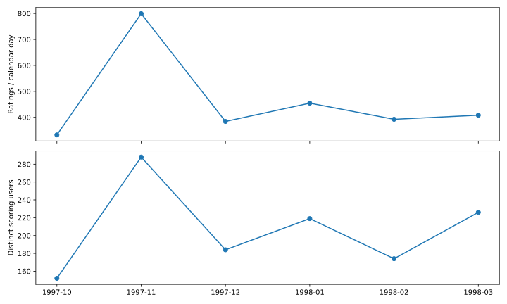
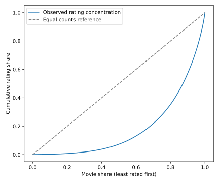

# 分析报告：MovieLens 内容评分与候选片单

本报告对应仓库中的实际代码和 `outputs/evidence.json`。各节说明使用的方法、选择理由、实际结果，以及结果支持的结论。

## 1. 分析任务与范围

设定为公开数据的内容编辑分析案例：了解评分参与、电影评分证据的集中程度、类型结构和候选榜单。不是企业线上实验，也不把评分数据解释为曝光、观看或收入。

数据来源为固定版本的 MovieLens 100K。原包包含评分明细、电影目录、类型编码和用户表；这里只使用用户ID核对关联，不做人口属性推断。用户筛选与主动评分机制限制了代表性，历史样本不能外推到今天所有观众。

| 表 | 粒度 | 作用 |
|---|---|---|
| ratings | 一条用户电影评分 | 评分、提交时间、用户和电影ID |
| movies | 一个源电影ID | 标题与发行日期 |
| movie_genres | 一个电影ID×类型 | 保留真实多标签关系 |

评分按UTC提交月统计，不等于观影月；同名不同ID保留为目录条目，不声称已人工完成唯一作品归并。

## 2. 数据质量检查与处理

**方法与理由：** 对关键字段检查缺失、重复和取值范围，按ID检查表间关联，并解析时间和日期。这样可以区分会影响统计的错误与可以保留的字段缺失，避免用全表删除缺失值的方式损失有效评分。

**实际结果与处理：**

| 检查 | 实际发现 | 处理与理由 |
|---|---|---|
| 评分缺失/重复组合/越界 | 0/0/0 | 保留全部有效评分；1星、5星本身不是脏数据 |
| 电影ID重复/孤儿电影关联 | 0/0 | 使用ID作为键，多对一关联核对数量 |
| 同名目录组 | 18 | 标题相同不等于ID重复，保留源目录条目 |
| 发行日期缺失/非空解析失败 | 1/0 | 缺失保留NaT，不补造日期、不删有效评分 |
| 视频日期/URL缺失 | 1682/3 | 非本次关键字段，不做全表dropna |
| 多类型/unknown电影 | 849/2 | 按真实标记拆表，unknown保留 |
| 电影类型关联行 | 2893 | 一片可多类型，不与电影数混淆 |
| 处理后评分/电影 | 100,000/1,682 | 全部有效原始记录保留 |

**结论：** 通过关键字段检查和ID关联检查，未发现评分缺失、重复用户电影组合、越界评分或孤儿电影关联，因此本次保留全部100,000条评分和1,682个电影ID。18个同名组按不同源ID保留，所以后续的“电影数”指目录ID数，不代表已经归并的唯一作品数。

质量记录见 `evidence.quality`。代码用 `merge(validate=...)` 检查关联关系；评分时间转为UTC，发行日期转为datetime/NaT，年份为可空整数。

## 3. 月度参与：人数与人均量分别怎样变化

**方法与理由：** 按UTC月份 `groupby`，用 `size` 计算评分条数、`nunique` 计算评分用户数，再计算人均评分数与日历日均评分数。利用“评分总量=评分人数×人均评分数”拆解总量变化；按日历天数计算日均，减少月份长短不同对总量比较的影响。首尾1997-09、1998-04只覆盖部分日期，下面比较完整月份。

**实际结果：**

| 完整月份 | 评分数 | 评分用户 | 人均评分 | 日历日均 | 有记录天数/日历天数 |
|---|---|---|---|---|---|
| 1997-10 | 10,304 | 152 | 67.79 | 332.39 | 31/31 |
| 1997-11 | 23,980 | 288 | 83.26 | 799.33 | 30/30 |
| 1997-12 | 11,911 | 184 | 64.73 | 384.23 | 29/31 |
| 1998-01 | 14,095 | 219 | 64.36 | 454.68 | 31/31 |
| 1998-02 | 10,991 | 174 | 63.17 | 392.54 | 28/28 |
| 1998-03 | 12,656 | 226 | 56.00 | 408.26 | 31/31 |

**结论：** 通过完整月份分组和人数、人均量分解，发现1997-10到11月的评分量由10,304增至23,980，同时评分用户由152增至288、人均评分由67.79增至83.26。因此，这段评分总量增长同时伴随参与人数和人均记录量上升；仅用“评分人数增加”不能完整描述总量变化。完整月序列随后有升有降，没有持续单向上升。

这里的分解是对观测数量的算术解释，不说明增长由某个活动或内容质量引起。1997-12有31个日历日、29天出现评分记录，日均仍按31天计算。月评分用户指提交过评分的人，不能直接解释为平台月活。

## 4. 评分集中度：头部和长尾分别拥有多少证据

**方法与理由：** 先按电影ID聚合评分数，再关联完整目录，将无评分目录的计数补0。按评分数降序、movie_id升序固定并列规则，计算头部影片的累计评分份额。Top比例部数向上取整；将≤20条评分定义为本次分析的低样本长尾。该方法同时比较影片数量占比和评分数量占比，判断评分证据是否均匀分布。

**实际结果：**

| 分组 | 影片数 | 评分数 | 评分份额 |
|---|---|---|---|
| Top10% | 169 | 42,871 | 42.871% |
| Top20% | 337 | 64,719 | 64.719% |
| ≤20条评分 | 755 | 5,272 | 5.272% |

**结论：** 通过电影级聚合、排序和累计份额计算，发现评分最多的169部电影获得42.871%的评分；755部低样本电影占目录44.887%，却只获得5.272%的评分。因此，这份样本的评分证据集中在头部，大量目录条目只有较少评分。这里衡量的是评分记录的分布，不是播放量或市场份额。Top10%包含在Top20%中，表内三行不能相加。

## 5. 类型结构：处理多标签重复计算

**方法与理由：** 将评分与电影类型桥表连接，保留一部电影属于多个类型的关系。为计算可加总的类型份额，给每条展开记录分配 `1/k` 权重，k是该片的类型数，使一条原始评分在所有标签中的权重合计为1。另计算三种均分，区分“每条评分的平均分”与“每部电影的平均分”。

- 评分等权均分：标签内全部评分求平均，评分多的电影影响更大。
- 1/k均分：标签内各条评分先乘以1/k，再用加权总分除以权重总量。
- 电影等权均分：先求每部电影的均分，再对标签内电影均分求平均，让每部电影权重相同。

**实际结果：** 100,000条评分连接类型后展开为212,595行，1/k分摊后的权重合计约100,000。展开增加的是标签关联行，不是独立评分。下表按分摊评分量列前五类。

| 类型 | 影片数 | 全额标签评分行 | 分摊份额 | 评分等权均分 | 1/k均分 | 电影等权均分 |
|---|---|---|---|---|---|---|
| Drama | 725 | 39,895 | 24.61% | 3.687 | 3.683 | 3.187 |
| Comedy | 505 | 29,832 | 18.29% | 3.394 | 3.350 | 3.001 |
| Action | 251 | 25,589 | 9.59% | 3.480 | 3.423 | 2.966 |
| Thriller | 251 | 21,872 | 9.40% | 3.509 | 3.496 | 3.137 |
| Romance | 247 | 19,461 | 8.10% | 3.622 | 3.582 | 3.244 |

**结论：** 通过1/k等比分摊，得到Drama和Comedy分别占分摊评分量24.61%和18.29%，是该口径下评分量最大的两类。通过三种均分对照，得到Drama的评分等权均分为3.687、电影等权均分为3.187，说明“平均一条评分”和“平均一部电影”会给出不同结果，不能混用口径。前者按评分条数赋予电影不同影响，后者让电影等权。

1/k是分配多标签记录的记账规则，不表示观众注意力真实均分。全额标签评分数和类型去重用户数不能跨类型相加；类型均分也不能解释为某个类型本身造成更高满意度。

## 6. 口碑候选：样本量门槛与收缩均分

**方法与理由：** 先按电影聚合评分数n、原均分和4/5星比例，筛选n≥30的电影，再用收缩均分排序。直接按原均分排名容易让评分较少的电影占据榜首；收缩均分同时考虑评分量和评分水平，让小样本的均分更靠近整体水平。

全局均分C为3.52986，主参数m=50，计算公式为：

`收缩分 = (n × 原均分 + m × C) / (n + m)`

这相当于在电影已有的n条评分之外，加入m条得分为全局均分的参考评分。n越小，参考评分的影响越大。收缩是向全局均分移动，不是一律降低评分；n≥30与m=50是本次分析设定。

**实际结果：** 下表是m=50时按收缩分排序的前十名。

| 排名 | 影片 | 评分数 | 原均分 | 收缩分 | 4/5星比例 |
|---|---|---|---|---|---|
| 1 | Schindler's List (1993) | 298 | 4.466 | 4.332 | 88.9% |
| 2 | Shawshank Redemption, The (1994) | 283 | 4.445 | 4.308 | 90.1% |
| 3 | Casablanca (1942) | 243 | 4.457 | 4.299 | 88.9% |
| 4 | Star Wars (1977) | 583 | 4.358 | 4.293 | 85.9% |
| 5 | Usual Suspects, The (1995) | 267 | 4.386 | 4.251 | 86.9% |
| 6 | Rear Window (1954) | 209 | 4.388 | 4.222 | 88.5% |
| 7 | Silence of the Lambs, The (1991) | 390 | 4.290 | 4.203 | 88.2% |
| 8 | Godfather, The (1972) | 413 | 4.283 | 4.202 | 85.0% |
| 9 | Close Shave, A (1995) | 112 | 4.491 | 4.194 | 89.3% |
| 10 | Wrong Trousers, The (1993) | 118 | 4.466 | 4.187 | 89.0% |

**结论：** 通过评分量门槛与收缩均分排序，Schindler's List以298条评分、原均分4.466、收缩分4.332位列第一。A Close Shave虽然原均分更高（4.491），但只有112条评分，收缩后为4.194，位列第九。这个对照说明本次片单同时考虑了均分和样本量，较高原均分不一定得到较高收缩排名；排名反映当前规则下的历史评分结果。

## 7. 已实际完成的敏感性分析

**方法与理由：** 固定同一份数据与n≥30门槛，仅将收缩参数m设为20、50、100，分别取Top20。比较共同影片数和Jaccard（交集数/并集数），观察参数变化会改变多少候选成员。只改变m，可以将这组差异对应到收缩强度的变化。

**实际结果：**

| m比较 | Top20共同影片 | Jaccard（交集/并集） |
|---|---|---|
| 20 vs 50 | 19/20 | 90.48% |
| 50 vs 100 | 18/20 | 81.82% |
| 20 vs 100 | 17/20 | 73.91% |

**结论：** 通过固定评分门槛、改变收缩参数的敏感性分析，m=20与m=100的Top20共有17部电影，Jaccard为73.91%。即两份20部片单中各有3部未出现在另一份中，主要成员相同，部分候选随参数变化发生替换。这个结果只描述候选成员的变化；共同成员不代表顺序相同，也不代表推荐效果或统计显著性。

## 8. 分析结论汇总

| 使用的方法 | 得到的结果 | 由此得出的结论 |
|---|---|---|
| 关键字段、重复组合、取值范围与ID关联检查 | 保留100,000条评分和1,682个电影ID，评分缺失、重复组合、越界及孤儿电影关联均为0 | 本次统计使用全部有效原始评分，电影数量按源ID计算 |
| 完整月分组，并按“评分总量=人数×人均”拆解 | 1997-10到11月：总量10,304→23,980，人数152→288，人均67.79→83.26 | 该段总量增长同时伴随评分人数与人均记录量上升 |
| 电影级计数、排序、累计份额与低样本切片 | 前169部占评分42.871%；755部低样本影片占目录44.887%，仅占评分5.272% | 评分证据集中在头部，目录中大量影片评分较少 |
| 多标签1/k等比分摊 | 212,595条展开行恢复为约100,000总权重；Drama占24.61%，Comedy占18.29% | 两类在分摊评分量中占比最高，展开行数不能当独立评分数 |
| 评分等权、1/k计权和电影等权均分对照 | Drama三种均分分别为3.687、3.683、3.187 | 不同权重回答不同问题，类型均分必须连同计算口径解释 |
| n≥30筛选与m=50收缩均分排序 | Schindler's List收缩分4.332，位列第一；原均分更高的A Close Shave为4.194，位列第九 | 候选排序同时考虑评分水平和评分量，不只按原均分选片 |
| 固定n≥30，比较m=20/50/100的Top20集合 | m=20与100共同17部，Jaccard为73.91% | 两份片单主要成员相同，仍有部分候选受收缩强度影响 |

以上结论均来自已完成的描述性统计、加权汇总、规则排序和参数敏感性分析，适用于这份历史评分样本。

## 9. 代码与结果来源

入口为 [fenxi.py](../fenxi.py)，由它统一调用 [rating_lab](../rating_lab/) 内的函数。完整数值保存在 [evidence.json](../outputs/evidence.json)，其中 `quality`、`monthly`、`concentration`、`genre`、`top30_candidates`、`sensitivity` 和 `top20_overlap` 分别对应本报告的质量检查及各项分析。

运行方法见 [README](../README.md)。

数据来源：[GroupLens](https://grouplens.org/datasets/movielens/100k/)、[官方README和许可](https://files.grouplens.org/datasets/movielens/ml-100k-README.txt)。原包SHA-256为 `50d2a982c66986937beb9ffb3aa76efe955bf3d5c6b761f4e3a7cd717c6a3229`。代码许可不覆盖源数据，发布内容不包含原包或行级评分。
