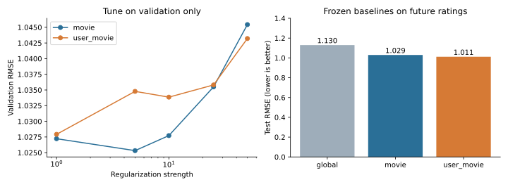
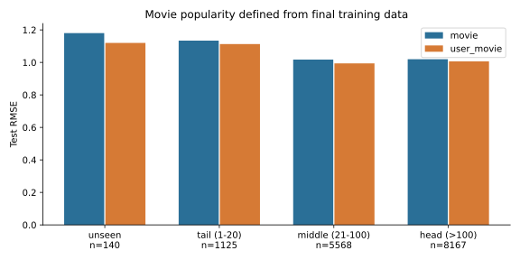
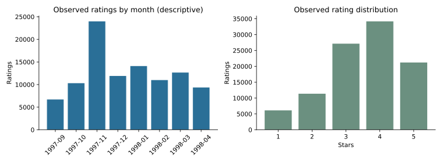

# 初版基线报告

本报告由 `python -m rating_lab run` 生成；这是待你解释和改进的起点。

## 问题与实验协议

用户和电影偏置能否改善未来记录评分的预测误差？

使用固定 MovieLens 100K；按全局评分时间近似 70%/15%/15% 切分，同时间戳不跨集合。各基线在验证集选择正则化后，用训练+验证集重拟合，再统一评估测试集。

| 集合 | 评分数 | 用户数 | 开始 UTC | 结束 UTC |
|---|---:|---:|---|---|
| train | 69997 | 674 | 1997-09-20T03:05:10+00:00 | 1998-02-09T15:46:04+00:00 |
| validation | 15003 | 247 | 1998-02-09T15:47:51+00:00 | 1998-03-27T22:06:54+00:00 |
| test | 15000 | 226 | 1998-03-27T22:07:03+00:00 | 1998-04-22T23:10:38+00:00 |

## 冻结后的基线

| 模型 | 正则化 | Test RMSE ↓ | Test MAE ↓ |
|---|---:|---:|---:|
| global | 0 | 1.1296 | 0.9585 |
| movie | 5 | 1.0295 | 0.8333 |
| user_movie | 1 | 1.0115 | 0.8091 |

## 不确定性与覆盖率

预设比较为 `user_movie − movie`。按测试用户整簇、成对重采样 2000 次，RMSE 差为 **-0.0180**，95% 百分位区间 **[-0.0403, -0.0009]**。区间整体低于 0，此次测试中加入用户偏置的模型误差较低。 区间条件于当前已训练模型、测试用户群和时间窗口；没有包含重训或时间漂移的不确定性。

- known_user_fraction: 16.8%
- known_movie_fraction: 99.1%
- both_known_fraction: 16.2%
- both_unknown_fraction: 0.4%

## 分组误差

| 分组 | 评分数 | 用户数 | movie RMSE | user_movie RMSE |
|---|---:|---:|---:|---:|
| unseen | 140 | 55 | 1.1804 | 1.1200 |
| tail (1-20) | 1125 | 162 | 1.1341 | 1.1131 |
| middle (21-100) | 5568 | 207 | 1.0174 | 0.9941 |
| head (>100) | 8167 | 214 | 1.0197 | 1.0066 |
| known_user | 2514 | 91 | 1.0662 | 0.9531 |
| unseen_user | 12486 | 135 | 1.0219 | 1.0228 |

## 解释边界

- 仅衡量被主动记录的评分；没有曝光、点击或未喜欢的完整记录，不能当作线上推荐效果。
- 1997–1998 年的历史样本且用户至少有 20 条评分；不能外推到今天所有观众或新用户。
- 时间戳是评分提交时间；不等于观影或影片发行时间。
- 分组误差是描述性诊断，没有分组显著性或因果结论；小分组尤其不稳定。
- 初版已展示测试集结果。改进实验应另定更晚时间窗/滚动验证，不能反复看本测试集调参后再宣称独立确认。

## 你的第一次分析提交

1. 用自己的话解释已知用户覆盖率，以及它如何影响用户偏置的价值。
2. 从验证集正则化曲线选一个观察，写出机制假设和一个能推翻它的实验。
3. 在 `docs/MY_FINDINGS.md` 写 300 字结果解释，引用数值、反例与适用范围。

完整聚合指标和运行环境见 [metrics.json](metrics.json)。
