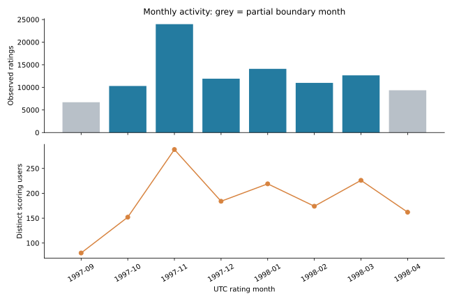
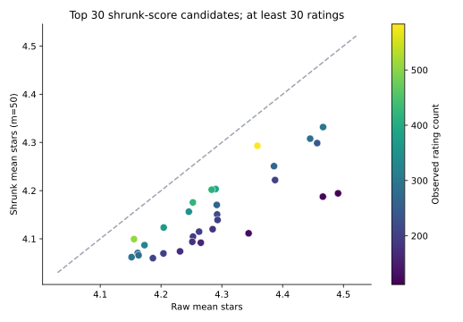

# 电影评分活动与候选片单分析

## 结论与使用范围

本案例分析100,000条已记录评分、943位评分用户和1,682部电影；全样本均分为3.52986星。
完整月中1997-11的评分记录最多；评分最多的约前10%电影占42.87%，≤20条评分的电影占目录44.89%，却只贡献评分5.27%。
这些结果支持进一步核查评分活动的组成，以及建立分层的人工评审片单；不能据此预测播放量、收入、市场需求或上线推荐收益。

## 数据与分析口径

固定MovieLens 100K，分析范围为全部历史已记录评分；按UTC评分提交时间统计，不使用模型训练/验证/测试切分。首尾月份保守标为不完整月，月间比较使用1997-10至1998-03六个完整日历月。
电影主键为movie_id，同名不同ID不合并；发行日期缺失保留NULL，unknown类型按真实标记保留，1星和5星都不作为脏数据删除。具体缺失、重复、孤儿外键与行数守恒检查见[audit.json](audit.json)。
原始档案、行级表和SQLite仅留在data目录；本报告和[metrics.json](metrics.json)发布聚合结果。

## 问题一：完整月份的评分活动怎样变化？

“评分用户”是当月至少提交一条评分的去重用户，不是平台注册用户、平台MAU或新增用户。日均以完整月的日历天数为分母，人均以当月去重评分用户为分母。

| 月份 | 评分记录 | 去重评分用户 | 每评分用户记录数 | 日均记录 | 有记录日/日历日 | 均分 |
|---|---:|---:|---:|---:|---:|---:|
| 1997-10 | 10,304 | 152 | 67.79 | 332.39 | 31/31 | 3.591 |
| 1997-11 | 23,980 | 288 | 83.26 | 799.33 | 30/30 | 3.560 |
| 1997-12 | 11,911 | 184 | 64.73 | 384.23 | 29/31 | 3.580 |
| 1998-01 | 14,095 | 219 | 64.36 | 454.68 | 31/31 | 3.398 |
| 1998-02 | 10,991 | 174 | 63.17 | 392.54 | 28/28 | 3.455 |
| 1998-03 | 12,656 | 226 | 56.00 | 408.26 | 31/31 | 3.549 |

1997-11记录23,980条评分、288位评分用户，人均83.26条；作为对照，1997-10为10,304条、152人、人均67.79条。评分量变化同时涉及参与评分的人数与每人的记录量，不能将人数或均分变化直接归因于内容质量、营销或用户留存。
1997-12的31个日历日里只有29日出现评分记录；另2日没有被记录的评分，不能证明那两天无人观看、无人使用平台或没有其他行为。因此日均仍除以31，而不是除以29；进一步解释需要核查采集完整性及行为日志。

## 问题二：评分活动集中在多少部电影上？

在全部目录电影中，按评分数降序、movie_id升序处理并列；Top比例对应的电影数向上取整。这里的集中度描述评分记录，不能当作观看集中度或市场份额。

| 分组 | 电影数 | 评分记录 | 评分占比 |
|---|---:|---:|---:|
| 约前10%电影 | 169 | 42,871 | 42.87% |
| 约前20%电影 | 337 | 64,719 | 64.72% |
| ≤20条评分电影 | 755 | 5,272 | 5.27% |

长尾组占目录电影44.89%。头部两行是嵌套分组，不能相加。长尾评分少可能涉及曝光、片库可用性、用户选择和采集机制，不能直接解释为没有需求。

## 问题三：电影类型怎样比较，才能避免多标签重复计数？

按真实类型标记关联后，100,000条评分展开为212,595条类型评分关联。一部电影有k个类型时，将每条评分按1/k分摊，分摊评分数可加总回100,000、分摊占比可加总为100%。这是分析归属约定，不是被观测到的观看份额。下表按分摊占比列前五类型。

| 类型 | 涉及电影 | 普通评分数 | 分摊评分数 | 分摊占比 | 普通均分 | 分摊均分 | 等电影均分 |
|---|---:|---:|---:|---:|---:|---:|---:|
| Drama | 725 | 39,895 | 24,607.20 | 24.61% | 3.687 | 3.683 | 3.187 |
| Comedy | 505 | 29,832 | 18,292.70 | 18.29% | 3.394 | 3.350 | 3.001 |
| Action | 251 | 25,589 | 9,591.47 | 9.59% | 3.480 | 3.423 | 2.966 |
| Thriller | 251 | 21,872 | 9,400.65 | 9.40% | 3.509 | 3.496 | 3.137 |
| Romance | 247 | 19,461 | 8,095.28 | 8.10% | 3.622 | 3.582 | 3.244 |

普通均分按评分记录计权，分摊均分按1/k计权；等电影均分先算每部电影的均分，再让每部电影权重相同。三种均值回答不同问题，类型间均分差异也可能来自电影和评分者组成，不能视作类型造成的偏好差异。普通类型评分数、类型涉及电影数以及去重评分用户数均会跨标签重叠，不能直接相加。

## 问题四：怎样建立样本量较稳妥的候选片单？

先要求n≥30条评分，再用全局均分C=3.52986，计算收缩分(n×原始均分+m×C)/(n+m)，主方案m=50。同样的原始均分下，评分较少的电影向C收缩更多。n≥30门槛和m=50都是透明的分析约定，不能称为已证实的最优参数。

| 收缩排名 | 电影 | 评分数 | 原始均分 | 收缩均分 | ≥4星比例 |
|---:|---|---:|---:|---:|---:|
| 1 | Schindler's List (1993) | 298 | 4.466 | 4.332 | 88.9% |
| 2 | Shawshank Redemption, The (1994) | 283 | 4.445 | 4.308 | 90.1% |
| 3 | Casablanca (1942) | 243 | 4.457 | 4.299 | 88.9% |
| 4 | Star Wars (1977) | 583 | 4.358 | 4.293 | 85.9% |
| 5 | Usual Suspects, The (1995) | 267 | 4.386 | 4.251 | 86.9% |
| 6 | Rear Window (1954) | 209 | 4.388 | 4.222 | 88.5% |
| 7 | Silence of the Lambs, The (1991) | 390 | 4.290 | 4.203 | 88.2% |
| 8 | Godfather, The (1972) | 413 | 4.283 | 4.202 | 85.0% |
| 9 | Close Shave, A (1995) | 112 | 4.491 | 4.194 | 89.3% |
| 10 | Wrong Trousers, The (1993) | 118 | 4.466 | 4.187 | 89.0% |

将m改为20、50、100，分别保留前20名，检验成员对先验强度的敏感性：

| 两个m方案 | Top20共同电影 | 交集/并集（Jaccard） |
|---|---:|---:|
| 20 与 50 | 19/20 | 90.48% |
| 20 与 100 | 17/20 | 73.91% |
| 50 与 100 | 18/20 | 81.82% |

Top20成员的重合不代表内部名次顺序相同，也不是统计显著性或排名可靠性的证明；完整名次保存在metrics.json。该片单仅作为历史样本上的人工评审候选，未证明这些电影适合某个用户，也未验证投放或推荐收益。

## 从证据到有限建议

| 现有证据 | 当前可以提出的有限建议 | 进一步决策需要的新数据 |
|---|---|---|
| 完整月中1997-11有23,980条评分、288位评分用户，参与人数和人均记录量均与其他月份不同。 | 先将月度监测拆成评分人数、人均评分和日均评分，核查波动来源；不直接归因内容或营销效果。 | 采集运行与缺失日志、曝光/观看事件、用户进入评分样本的方式和活动日历；若评估活动效果，还需要对照或随机实验。 |
| 约前10%电影占评分42.87%；长尾占电影44.89%、评分仅5.27%。 | 人工评审与探索性片单保留头部/长尾分层，先设样本量和观测窗口；不按评分份额直接分配商业预算。 | 片库可用性、展示位置与曝光量、观看转化及留存、成本与权利信息；上线探索需合适的实验设计。 |
| Drama分摊占比24.61%；候选Top20会随m变化，且所有候选均满足n≥30。 | 将类型分摊结果作为样本描述，将收缩片单作为人工复核起点，并保留敏感性结果；不把m=50当最优，也不将片单当个体推荐。 | 更新时期的评分与评分质量审查、实际可用片库、曝光和观看数据、目标用户需求，以及预先固定指标的试验结果。 |

## 限制与复现

用户和评分记录都存在选择偏差；1997–1998年的历史样本不能代表今天所有观众。没有曝光、观看或随机分配数据，描述性差异不能证明因果。先验强度敏感性也不涵盖抽样误差、异常评分机制或时期变化。
从项目目录运行`python -m rating_lab.analyst`可重建本报告；SQL位于[analysis.sql](../../sql/analysis.sql)。完整聚合表见[metrics.json](metrics.json)，源数据审计见[audit.json](audit.json)。
固定原包SHA-256：`50d2a982c66986937beb9ffb3aa76efe955bf3d5c6b761f4e3a7cd717c6a3229`。代码许可不覆盖MovieLens源数据，发布内容保持为聚合结果。
后续按[学习指南](../../docs/LEARNING_GUIDE.md)复核口径、执行SQL并写出自己的结论。
